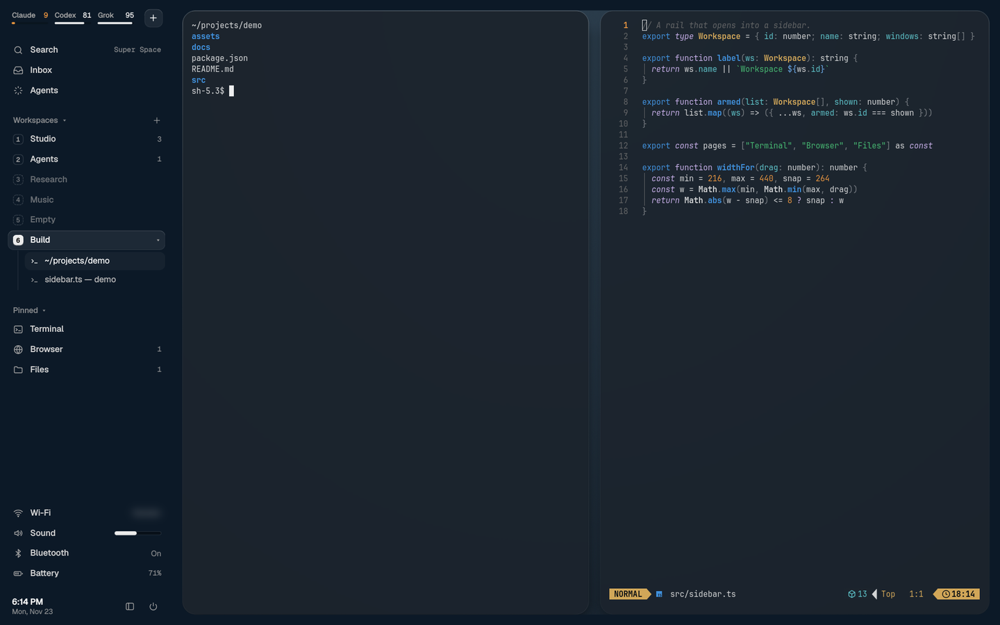
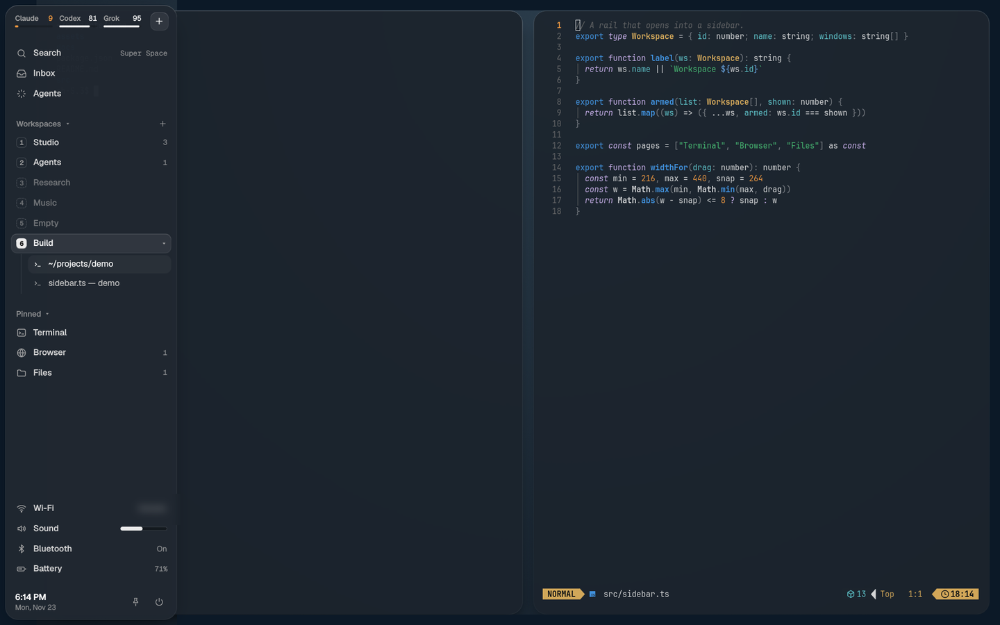
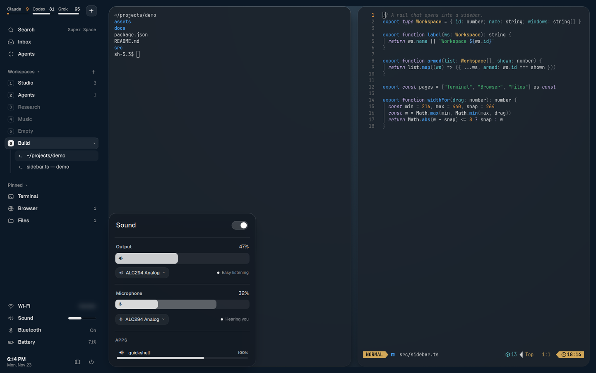
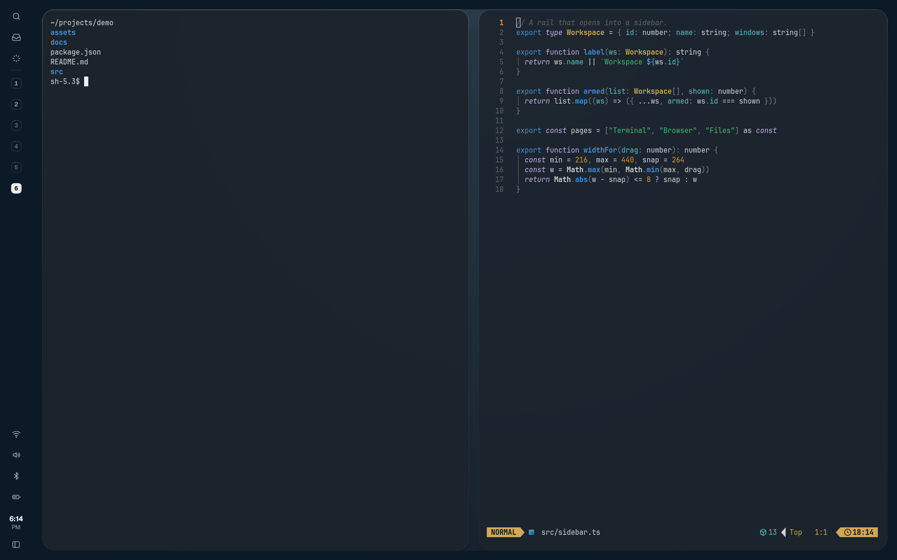

# Sidecar

A bar for [Omarchy](https://omarchy.org): a 56px rail on the left edge of the screen that opens
into a sidebar of your workspaces, their windows, pinned app pages and system rows. It is styled
after DeepLethe's [Solid Glass](https://github.com/deeplethe/solid-glass): neutral grey panes, a
hairline and a line of light at each pane's edge, one clear state for hovered and chosen, and one
solid ink for what asks to be pressed. Status dots and a running-low usage bar are the only
colour.



| Floating over the windows | A panel beside it | Folded to the rail |
|---|---|---|
|  |  |  |

Needs Omarchy 4.5 or later (Hyprland with the Lua config).

## What it does

- **Rail (56px):** Search, Inbox, Agents, one chip per workspace (click to switch, scroll to
  cycle), Wi-Fi, Sound (scroll changes volume), Bluetooth, Battery, the time, and a pin button.
  Tooltips stand to the right.
- **Sidebar (264px):** rest the pointer on the rail for 200ms and it floats over your windows as a
  card; it folds 260ms after the pointer leaves. Pin it and it becomes part of the page: the
  windows move over to make room.
- **Resize:** drag the sidebar's right edge (216 to 440px, snaps to 264 near it, double-click
  resets). Drag it far left and let go to fold it back to the rail.
- **Workspaces:** each with its number, a name you can give it (double-click or right-click the
  row, Enter keeps it, Escape leaves it), and the window count. The workspace you are on lists its
  windows; click one to focus it. A highlight pill flows from row to row as you move.
- **Pinned app pages:** Terminal, Browser and Files each get a workspace of their own, named
  after the app. Click the row to go there (it opens the app if the page is empty); Terminal has
  a `+` for one more window. A tiled window of another app that opens on a page is sent to its
  own page, or back to the numbered workspace you came from.
- **Sound source:** while something plays, the window it comes from shows a speaker (click it to
  mute that app only), its workspace row and rail chip show a mark, and the Sound row names the
  app.
- **System rows** open Omarchy's own panels (network, audio, bluetooth, power, agents) beside the
  rail or the sidebar. Sidecar keeps the panel widgets from your `bar.layout` loaded but never
  draws them; if your layout has none of a kind, it loads the stock `omarchy.*` one.
- **Inbox** puts the last few notifications back on screen (the stock notification history).
- **Footer:** time, date, pin and power (Omarchy's system menu).
- **Header:** how much is left on each AI subscription (Claude, Codex, Grok, up to three), as a
  percentage and a thin bar, with `+` (the app grid) beside it. The numbers come from the
  records Omarchy's own Agents panel keeps (`~/.local/state/omarchy/agents/usage/`), read every
  two minutes; each agent shows its fullest limit window, since that is the one that stops you.
  Click it for the Agents panel. With no records the strip is simply empty.
- **Frame:** the sidebar's page colour carries on round the top, right and bottom, filling
  Hyprland's outer gap, so the rail or sidebar and the frame read as one shell and each window's
  own edge is the only outline. It reserves no space and never covers a window; its corners
  follow your window rounding. Turn it off with `omarchy-shell sidecar frame off`.
- **Theme:** follows your Omarchy theme's light or dark mode, and its tone: the grey panes lean
  a little toward the theme's hue (never more than a tint), and a dark theme with a lifted page
  lifts the sidebar's page with it. Follows the language set under Setup > Language. Uses Geist
  when it is installed, else the shell's font.

Sidecar does not draw the tray, indicators, keyboard layout, update notice, weather or clock
card; their widgets in `bar.layout` are simply not loaded while Sidecar is the bar.

## Install

```bash
omarchy plugin add https://github.com/denonmaryland/omarchy-sidecar
omarchy plugin enable io.github.denonmaryland.sidecar   # use it as the bar
omarchy restart shell
```

`omarchy plugin add https://github.com/denonmaryland/omarchy-sidecar --enable` does both steps at once. A bar switch takes effect after
`omarchy restart shell`.

## Back to the stock bar, and uninstall

```bash
omarchy plugin disable io.github.denonmaryland.sidecar   # the stock bar comes back
omarchy restart shell
omarchy plugin remove io.github.denonmaryland.sidecar    # remove the files
```

Sidecar keeps its pin, width, frame and workspace names in `~/.config/omarchy/sidecar.json`; delete it
too if you want nothing left behind. It never writes to your Hyprland config.

## IPC

```bash
omarchy-shell sidecar toggle | expand | collapse | pin | unpin | state
omarchy-shell sidecar width               # current width in px
omarchy-shell sidecar setWidth 300        # clamped to 216..440, saved
omarchy-shell sidecar panel audio         # agents | network | audio | bluetooth | power
omarchy-shell sidecar name 3 "Mail"       # name workspace 3 ("" removes the name)
omarchy-shell sidecar names               # all names, as JSON
omarchy-shell sidecar rename 3            # open the row's name field
omarchy-shell sidecar page terminal       # terminal | browser | files
omarchy-shell sidecar another terminal    # one more window on that page
omarchy-shell sidecar sound               # [{ app, workspace, address, muted }]
omarchy-shell sidecar muteWindow 0x5f...  # mute or unmute one window's streams
omarchy-shell sidecar frame off           # on | off | toggle; prints the new state
```

`expand` opens the sidebar until Escape, another call, or the pointer has come in and left.
Bind `omarchy-shell sidecar toggle` to a key in `~/.config/hypr/bindings.lua` if you like.

## Optional Hyprland snippet

Sidecar works with Omarchy's default gaps; the frame is as thick as your outer gap. The design was
drawn with one 8px gap between windows,
the rail and the screen edges, and the floating card frosted. To get that, add this to a file of
your own under `~/.config/hypr/` (for example `looknfeel.lua`), then check `hyprctl configerrors`:

```lua
hl.config({ general = { gaps_in = 4, gaps_out = { top = 8, right = 8, bottom = 8, left = 8 } } })
hl.layer_rule({
  name = "sidecar",
  match = { namespace = "^sidecar$" },
  blur = true,
  ignore_alpha = 0.5,
  xray = true,
})
```

## Notes

- Helpers in `bin/`: `quiet-dispatch` runs one Hyprland dispatcher with cursor warps briefly off
  (so the pointer stays on the row you clicked) and puts your warp settings back;
  `page-guard` moves a stray window off an app page.
- Page workspaces are named `Terminal`, `Browser` and `Files` in Hyprland whatever your language;
  only their labels are translated.
- The rail's clock is 12-hour (`h:mm AP`).
- Text from windows, devices and audio streams is drawn as plain text only.
- Idle cost: with nothing changing, the sidebar does not redraw. Hidden panel widgets are kept
  `visible: false`, and spinner glyphs at the front of window titles are dropped, so a busy
  window does not make the sidebar redraw.
- Tests: `node tests/run.js`.

Future work: a real inbox (every notification kept, read or unread, in a view beside the
sidebar), tray and indicator rows, a calendar card, right-edge placement.

## Credits

- Design language: [Solid Glass](https://github.com/deeplethe/solid-glass) by DeepLethe, MIT.
  Sidecar's colour tokens are its stylesheet's variables, as neutral greys.
- Built on the Omarchy shell's plugin API.

MIT licence, see [LICENSE](LICENSE).
